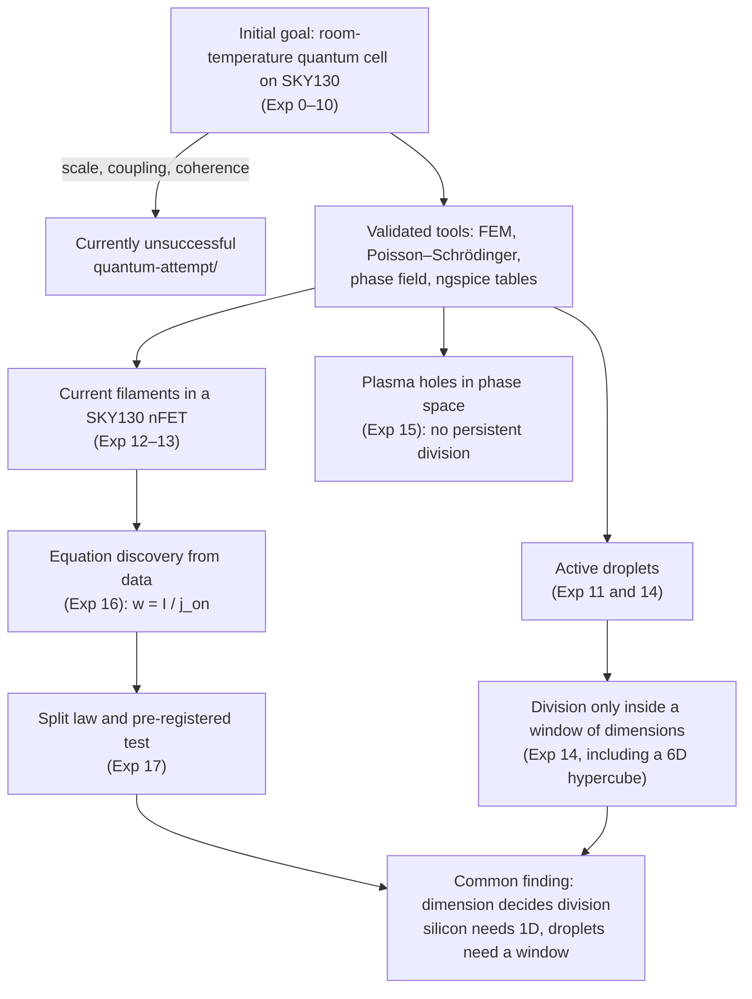
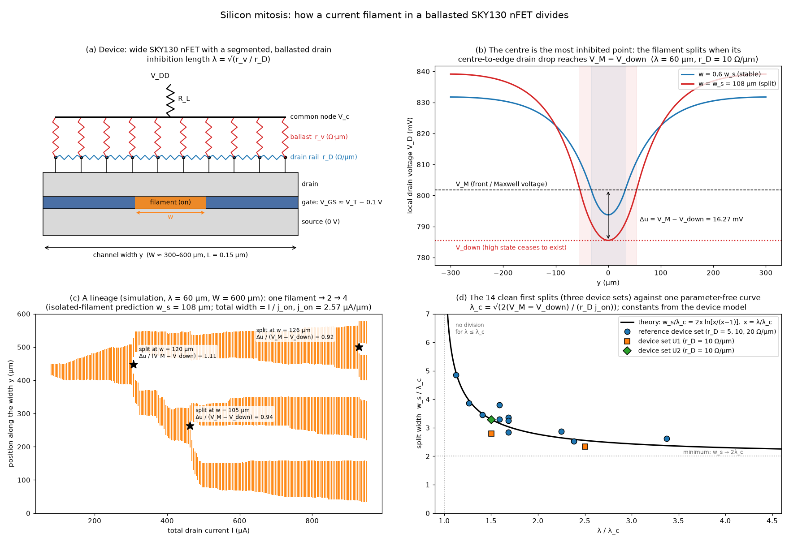
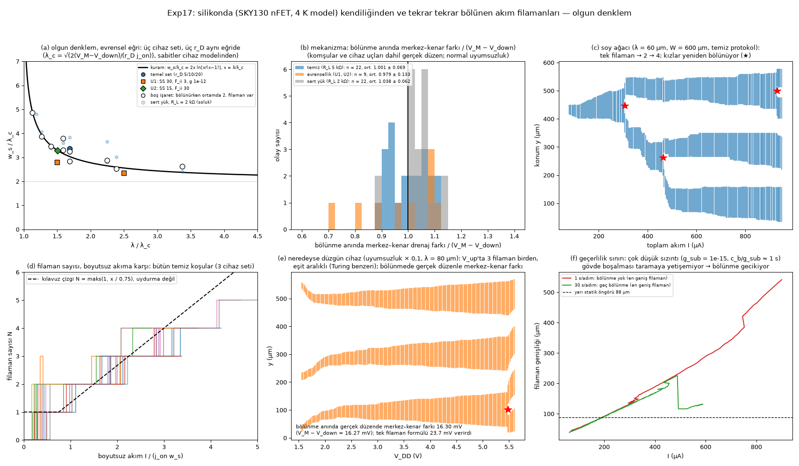
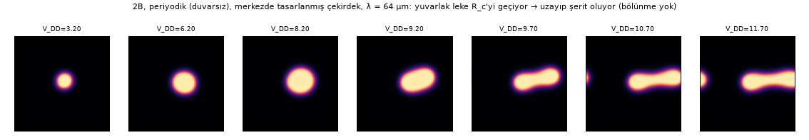
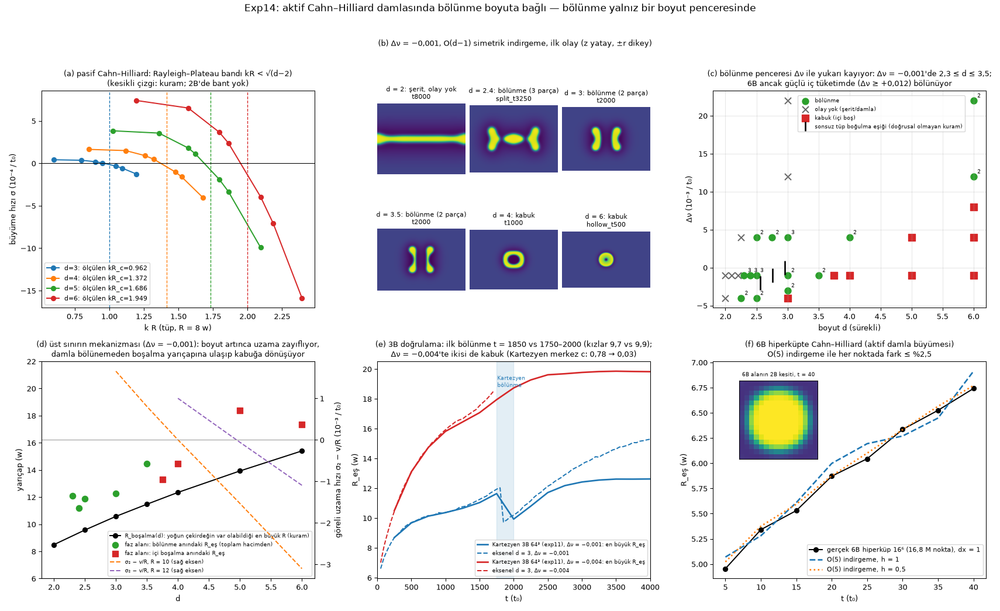

# Silicon Mitosis

**Self-dividing current filaments in standard silicon CMOS (SKY130): a parameter-free, pre-registered split law, and dimension-dependent division in active matter**

Research by **counfield** — <https://counfield.com/> · Türkçe: [README.tr.md](README.tr.md)

> **Status (October 2026).**
> - All results in this repository are **model and simulation results**; none has been measured on silicon yet.
> - The project began as an attempt to obtain a *quantum* device on a standard 130 nm process. That attempt is
>   **currently unsuccessful** and is documented separately in [`quantum-attempt/`](quantum-attempt/README.md).
> - The detailed per-experiment reports are in Turkish (`results/*/summary_*.md`). Corrections found in a pre-release audit
>   are listed in a box at the top of the affected reports; where they conflict with the original text, the box applies.

---

## Abstract

We ask whether a structure on an ordinary silicon chip can **grow and divide by itself**, like a biological cell, under a steady electrical drive.

**The device and the dividing structure.**
- We use a reduced model of the open-source SkyWater SKY130 `nfet_01v8` transistor. It is built from the foundry BSIM4 model card
  (simulated with ngspice) and extended with explicit, swept 4 K assumptions.
- In this model, a wide nFET biased just below threshold forms a **current filament**: a floating-body latch that turns on in only
  part of the channel width.
- If the drain is segmented and every segment is tied to the supply through its own ballast resistor, the filament **grows with
  current and divides in two, and its daughters divide again**.

**The split law.**
- A filament splits when the drain voltage at its centre falls to $V_\text{down}$, the lowest voltage at which the conducting state
  can exist.
- For an isolated filament this gives a closed-form split width, $w_s = 2\lambda\ln[\lambda/(\lambda-\lambda_c)]$. Its constants
  come from the device model; nothing is fitted.
- Predictions were saved before the simulations that test them. In the clean protocol (load $R_L$ = 5 kΩ), the centre-to-edge drain
  drop at the 22 observed splits equals the predicted margin within a factor of 1.001 ± 0.069 (range 0.89–1.11). For two very
  different device-parameter sets the factor is 0.98 ± 0.13 (9 splits). A stiffer load and very low body leakage delay the split
  (Section 3.1 lists all 63 analysed splits).
- First split widths of 14 clean runs follow the closed form with an RMS error of 9 %. One near-threshold prediction failed: at
  λ = 36 µm, 1 % above $\lambda_c$, the filament did not split.
- A fit with one free constant returns 1.01 × the theoretical value. Blind symbolic regression found no comparable compact law.

**Dimension.**
- The same "growth vs. division" competition is studied in a continuum model of chemically active droplets, in $d = 2 \dots 6$
  dimensions, including a genuine 6D Cahn–Hilliard hypercube.
- Division happens only inside a **window of dimensions**, and that window shifts with the chemical drive.
- In silicon the dividing geometry is one-dimensional: in 2D arrays the current spot elongates into a worm instead of dividing.

## Research map



## 1. Background and question

Two observations motivated the work.
- **(i) Stable, sized filaments.** Bistable (S-shaped) current–voltage characteristics are known to form current filaments in
  semiconductors (Schöll; Hüpper et al.). A *global* constraint, such as a load resistor, selects a single filament whose width
  grows with current.
- **(ii) Replicating spots.** Reaction–diffusion systems with a *local* inhibitor show self-replicating spots (Pearson 1993).

Our question: can a standard CMOS layout provide the local inhibitor, so that a current filament in silicon behaves like a dividing
cell? If so, what sets the division size?

## 2. Model

**Device level.** Experiments 12–13; `experiments/exp12_filament/`.
- **Tables.** The official SKY130 `nfet_01v8` card (tt corner, BSIM4.5) is simulated with ngspice to produce tables of drain current
  $I_d$, impact-ionisation current $I_\text{sub}$ and $V_T$ versus $(V_{gs}, V_{ds}, V_{bs})$.
- **Assumed 4 K physics.** Behaviour specific to 4 K is introduced as explicit, swept assumptions: subthreshold slope,
  impact-ionisation multiplier, body-diode onset, frozen-well leakage $g_\text{sub}$, lateral body sheet resistance.
- **Local bistability.** Each segment of width $dy$ has a body potential $V_b$ obeying
  $C_b\,\dot V_b = \kappa\,\partial_y^2 V_b + F_{ii}\,M(V_{D})\,j_d(V_b) - j_0 e^{(V_b - V_\text{on})/V_s} - g_\text{sub}V_b$.
  For a range of local drain voltage $V_D$ this has a low and a high (latched) state.
- **Reference device set** (`law.BASE`): subthreshold slope SS = 20 mV/dec; impact-ionisation multiplier $F_{ii}$ = 10; gate
  overdrive $V_{gs} - V_T$ = −0.1 V; body-diode onset $V_\text{on}$ = 1.05 V with e-folding voltage $V_s$ = 5 mV; frozen-well
  leakage $g_\text{sub}$ = $10^{-13}$ A/(V·µm). Two further sets test universality: U1 (SS = 30 mV/dec, $V_s$ = 10 mV,
  $F_{ii}$ = 3, $g_\text{sub}$ = $10^{-12}$) and U2 (SS = 15 mV/dec, $F_{ii}$ = 30).

**Inhibitor.** Experiments 13 and 17. The drain is a resistive rail ($r_D$, Ω/µm). Each point of the rail is tied to the common
node $V_c$ through a distributed ballast ($r_v$, Ω·µm). The drop $u = V_c - V_D$ obeys

$$u'' = \frac{u}{\lambda^2} - r_D\, j_d(y), \qquad \lambda = \sqrt{r_v / r_D}.$$

**Global constraint.** $V_c = V_{DD} - R_L I$. A filament's fronts are stationary at the equal-area (Maxwell) voltage $V_M$.

## 3. Main result: the split law



**Figure 1 — Mechanism.**
- **(a) The device.** A wide nFET whose drain is a resistive rail ($r_D$) with a ballast resistor ($r_v$) at every segment. The
  orange region is a current filament of width $w$.
- **(b) Drain voltage along the width**, computed with the rail solver for λ = 60 µm and $r_D$ = 10 Ω/µm. The filament draws
  current, so the drain voltage is depressed most at its **centre**; the edges (fronts) sit at $V_M$.
  - Blue: a filament of width 0.6 $w_s$. Its centre stays above $V_\text{down}$ and it is stable.
  - Red: the critical width $w_s$ = 108 µm. The centre reaches $V_\text{down}$, where the latched state ceases to exist. The centre
    switches off and the filament splits in two.
- **(c) A simulated lineage** (reference device, λ = 60 µm, $r_D$ = 10 Ω/µm, W = 600 µm, clean protocol; run `H_lam60_s1`).
  - One filament nucleates at I ≈ 80 µA and widens in proportion to the current.
  - It divides at w = 120 µm; the prediction for an isolated filament is 108 µm.
  - The daughters drift apart, grow, and each divides again, at 105 µm and 126 µm (1 → 2 → 4 filaments).
  - At the three splits, the criterion evaluated with the actual configuration gives Δu/($V_M - V_\text{down}$) = 1.11, 0.94 and
    0.92. The last split comes later than the isolated formula says, because the neighbouring filament and the device end reduce the
    central drop.
- **(d) The 14 clean first splits against the closed form.** Reference set at $r_D$ = 5, 10 and 20 Ω/µm; sets U1 and U2 at
  $r_D$ = 10 Ω/µm. First splits that happen while more than two filaments are present are not shown (one case, U2 at
  λ = 2.5 $\lambda_c$, which splits 18 % late).

**Derivation.** For a filament of width $w$ carrying $j_\text{on}$ per µm, the centre-to-edge drop is
$\Delta u = \tfrac{1}{2} r_v j_\text{on}\,(1-e^{-w/2\lambda})^2$. Setting $\Delta u = V_M - V_\text{down} \equiv \Delta V_c$ gives

$$\boxed{\,w_s = 2\lambda \ln\frac{\lambda}{\lambda-\lambda_c},\qquad \lambda_c=\sqrt{\frac{2\,(V_M-V_\text{down})}{r_D\, j_\text{on}}}\,}$$

- **Below threshold:** no division for $\lambda \le \lambda_c$.
- **Minimum:** the split width tends to $2\lambda_c$ for $\lambda \gg \lambda_c$.
- **Periodic arrays** (period $P$), from the same criterion: $\Delta u = r_v j_\text{on}(\cosh a - 1)/(\cosh a + \sinh a \coth b)$,
  with $a = w/2\lambda$ and $b = (P-w)/2\lambda$. This form is derived but **not tested** in this work.
- **Population:** the total filament width is $w_\text{tot} = I/j_\text{on}$. The filament count rises in steps, roughly as
  $N \approx I/(0.75\,j_\text{on} w_s)$; this line is a guide drawn in Fig. 2d, not a fit.

**Constants** of the reference device set:

| quantity | value | cross-check |
|---|---|---|
| $V_M$ | 0.8018 V | equal-area construction, Exp12 |
| $V_\text{down}$ | 0.7855 V | centre $V_D$ at the split observed in Exp13: ≈ 0.785 V |
| $\Delta V_c$ | 16.27 mV | |
| $j_\text{on}$ | 2.569 µA/µm | fitted from data in Exp16: 2.55 ± 0.03 |
| $\lambda_c$ | 50.3 / 35.6 / 25.2 µm | for $r_D$ = 5 / 10 / 20 Ω/µm |

### 3.1 Validation

Predictions were saved (`results/exp17/predictions*.json`) before the corresponding runs. At every detected split, the mechanism
check computes the centre-to-edge drop with the actual filament configuration (neighbours and device ends included) and divides it by
$\Delta V_c$. All 63 analysed splits, by protocol (`results/exp17/mechanism.json`; ± is the standard deviation over splits):

| protocol | splits | Δu / ΔV_c |
|---|---|---|
| clean: $R_L$ = 5 kΩ, normal mismatch | 22 | **1.001 ± 0.069** (0.89–1.11) |
| clean, mismatch × 0.1 | 2 | 1.03 |
| stiffer load: $R_L$ = 2 kΩ (labelled "hızlı", fast, in the data files; the step time is the same 1 s) | 22 | 1.038 ± 0.062 |
| stiffer load, mismatch × 0.1 | 7 | 1.14 ± 0.07 |
| device sets U1, U2 ($R_L$ = 5 kΩ) | 9 | **0.979 ± 0.133** |
| very low leakage, $g_\text{sub}$ = $10^{-15}$ | 1 | 2.60 |

| test | result |
|---|---|
| First split width, 14 clean runs (reference set: 8 at $r_D$ = 10, 2 at 20, 1 at 5 Ω/µm; U1, U2: 3 at 10 Ω/µm) | mean error +1.6 %, RMS 9.1 % |
| Below threshold: λ = 30 µm ($\lambda_c$ = 35.6 µm) | no split, as predicted |
| Just above threshold: λ = 36 µm | **miss.** Predicted split at w = 322 µm; the filament grew to 350 µm without splitting. Near threshold $w_s$ diverges: a 2.3 % larger $\Delta V_c$ would already put λ = 36 µm below threshold. |
| Total width $w_\text{tot} = I/j_\text{on}$ | ratio 1.00–1.02 (reference and U sets); 1.03–1.23 at very low leakage |
| One free constant $k$ ($\lambda_c = k/\sqrt{r_D}$), fitted to the 11 reference-set runs | $k$ = 1.010 × theory, leave-one-out (LOO) error 8.2 %; the parameter-free form has 7.75 % on the same runs |
| Competing forms | power law $A\lambda^a r_D^b$: LOO 11.5 %. Blind GP symbolic regression (gplearn): 32–70-node expressions, training error 4.3–11 % (no LOO), no compact law |
| Unit test | `tests/test_exp17.py`: closed form vs. discrete rail solver within 1 % (λ = 60 µm, $r_D$ = 10 Ω/µm) |



**Figure 2 — Experiment 17 summary** (labels in Turkish).
- **(a)** Universal curve with all first splits. Filled marker: one filament present at the split; open: two; faint: $R_L$ = 2 kΩ.
- **(b)** Histogram of Δu/ΔV_c at every split with normal mismatch: clean (n = 22), U1/U2 (n = 9), stiffer load (n = 22).
- **(c)** The lineage of Fig. 1c.
- **(d)** Filament number against the dimensionless current $I/(j_\text{on} w_s)$ for all clean runs. The dashed line is a guide, not
  a fit.
- **(e)** A nearly uniform device (mismatch × 0.1, λ = 80 µm).
  - Three filaments are born together at $V_{DD}$ ≈ 1.56 V and settle at about 101, 302 and 501 µm: equal spacing, Turing-like.
  - One of them divides at $V_{DD}$ ≈ 5.5 V. At that moment the centre-to-edge drop computed with the actual configuration is
    16.30 mV ($\Delta V_c$ = 16.27 mV); the isolated-filament formula would give 23.7 mV.
  - In nearly uniform devices with λ = 40–60 µm the triplet did not split up to $V_{DD}$ = 5.6 V.
- **(f)** Validity limit: very low leakage ($g_\text{sub} = 10^{-15}$; body discharge time $c_b/g_\text{sub}$ ≈ 1 s).
  - With the standard 1 s per step, the filament grows to 541 µm without splitting.
  - Sweeping 30 times slower, it splits at 225.5 µm, 2.6 times the quasi-static prediction of 88 µm.

### 3.2 Silicon "mitosis" needs a one-dimensional geometry

We also simulated a 2D array of finger segments with a 2D drain sheet and distributed ballast (`spatial2d.py`; λ = 64 µm, predicted
critical radius $R_c$ = 71 µm for an isolated disk). Runs used reflecting walls (T64, V64_small) or periodic boundaries with a
designed nucleation site (P64).
- **Elongation instead of division.** The current spot grows round and passes the predicted critical radius by about 3 % (T64) and
  10 % (P64). It then elongates, first into a dumbbell and then into a meandering stripe.
- **No central quench.** The centre never reaches $V_\text{down}$, because elongation relieves the central inhibition. There is no
  division up to 15.2 mA (P64). The spot labeller reports two pieces in the late P64 states; joining the periodic boundaries shows
  that they are one stripe.
- **Caveat.** Only 12–44 % of the voltage steps in these 2D runs reached the steady-state tolerance before the iteration limit. The
  states evolve smoothly, but the 2D sweeps are less quasi-static than the 1D ones, so the 2D result is weaker evidence.



**Figure 3 — 2D array with periodic boundaries and a designed nucleation site** (P64, λ = 64 µm): body potential at increasing
$V_{DD}$.
- The round spot becomes a dumbbell and then a stripe; it does not divide.
- In the last panels, the piece at the left edge is the right end of the same stripe, wrapped across the periodic boundary.

> **Design principle.** Division occurs when the conducting domain is confined to one dimension: the width of a wide transistor. In
> 2D, elongation wins.

### 3.3 A proposed SKY130 test structure (falsifiable)

- **Device:** `nfet_01v8`, W ≈ 600 µm, L = 0.15 µm, biased at $V_{gs} \approx V_T - 0.1$ V. The drain is swept slowly through
  ≈ 5 kΩ or a current source.
- **Drain rail:** `li1` strip, 1.28 µm wide (12.8 Ω/□ → 10 Ω/µm).
- **Ballast:** 3.6 kΩ per 10 µm segment for λ = 60 µm, using `res_high_po` (~300 Ω/□) or `res_xhigh_po` (2000 Ω/□). Sheet values
  are from the [SkyWater PDK documentation](https://skywater-pdk.readthedocs.io/en/main/rules/device-details.html).
- **Array:** λ = 30, 45, 60, 90 µm on one die, plus an unballasted control. Avoid λ within a few per cent of $\lambda_c$: there
  $w_s$ diverges and is very sensitive to the constants.
- **Prediction:** no split at 30 µm; $w_s = 2\lambda\ln[\lambda/(\lambda-\lambda_c)]$ otherwise; a staircase in the filament
  count, visible in the segment currents.
- **Parameter-free test:** all three constants can be measured on one reference device:
  - $V_M$: the clamp voltage of an unballasted filament;
  - $V_\text{down}$: the lower edge of the hysteresis in a narrow device;
  - $j_\text{on}$: $dI/dw$ along the plateau.

## 4. Division depends on dimension (active droplets, up to a 6D hypercube)

Experiment 14 (`results/exp14_dimension/`) studies chemically active Cahn–Hilliard droplets (the model of Zwicker et al., 2017) for
continuous dimension $d$.

**Methods.**
- An exact O(d−1)-symmetric reduction to the $(z, r)$ half-plane, with Laplacian $\partial_{zz} + \partial_{rr} + (d-2)r^{-1}\partial_r$.
- A lean Cartesian solver used up to a **genuine 6D hypercube** (16⁶ = 16.8 M points).
- A nonlinear sharp-interface theory written in the chemical potential.

**Results.**
- **Geometry.** Passive Rayleigh–Plateau breakup band $kR < \sqrt{d-2}$. Measured thresholds 0.962 / 1.372 / 1.686 / 1.949 for
  d = 3–6, against theory 1 / 1.414 / 1.732 / 2.
- **Division window.** Active droplets divide only for $2 < d \lesssim d_c(\Delta\nu)$:

  | chemical drive Δν | dimensions that divide |
  |---|---|
  | −0.004 | 2.25–2.5 |
  | −0.001 (Zwicker parameters) | 2.3–3.5 |
  | +0.004 | 2.5–4 |
  | +0.012 and +0.022 | 6D divides |

  Below the window the droplet becomes a strip. Above it, the core falls below the spinodal before the droplet can divide, and the
  droplet becomes a **hollow liquid shell**.
- **3D vs 6D.** They divide in *disjoint* drive windows (axisymmetric runs `axi/Z_*.json`):
  - 3D divides at Δν = −0.003…+0.004. It forms a hollow shell at −0.004 and shows no event at +0.012 and +0.022.
  - 6D divides only at Δν ≥ +0.012 and forms shells at −0.001…+0.008.
- **Validation.**
  - The reduction reproduces the full 3D Cartesian division: first split at t = 1850 against 1750–2000; daughter radii 9.7 against
    9.9.
  - It matches the 6D hypercube within 2.5 % during droplet growth (t ≤ 40).
  - The nonlinear theory reproduces 2D droplet radii within 1–6 % (ratio 0.99–1.06, 5 droplets). The linear effective-droplet
    theory does not (ratio 0.70–0.77, 9 droplets).



**Figure 4 — Experiment 14** (labels in Turkish).
- **(a)** Passive breakup band versus $kR$ for d = 3–6. Dashed lines: $\sqrt{d-2}$.
- **(b)** First event for d = 2 … 6 at Δν = −0.001: strip, division, or hollow shell.
- **(c)** Phase diagram in $(d, \Delta\nu)$: the division window and the 3D/6D comparison.
- **(d)** Why the window closes: the largest radius at which a dense core can exist, against the weakening elongation rate.
- **(e)** 3D validation against the full Cartesian runs.
- **(f)** Genuine 6D hypercube against the O(5) reduction.

**Related experiments.**
- **Experiment 15.** A collisionless plasma in 6D phase space, simulated with a validated particle-in-cell code. Electron holes
  merge in 1D, and break up and decay in 2D and 3D. No persistent division was seen.
- **Experiment 16.** Equation discovery from the project data with PySINDy.
  - From clean data it recovers the Gray–Scott equations and the Hartree–Fock compressibility.
  - BSIM4 impact ionisation was recovered only on a second attempt, after BSIM4's effective drain voltage was added to the candidate
    library; the first attempt found 0/90.
  - With 1 % noise the method fails (tested on Gray–Scott).
  - Other targets (body effect, FEM convergence) were recovered only approximately or not at all.

## 5. The quantum attempt (currently unsuccessful)

The original goal was a room-temperature quantum regime (Coulomb blockade, qubits) on a standard 130 nm process. In our
simulations it is not achievable:
- the required island size is 0.13–0.39 nm, while the minimum gate is 150 nm (a factor of about 380–1150);
- tunnel coupling across the 210 nm poly spacing is about $10^{-29}$;
- at 300 K the polarisation is at most 0.74 and the gate fidelity at most 0.78.

A retracted accidental-dot prediction and the missing cryogenic data are documented there. Full account:
[`quantum-attempt/README.md`](quantum-attempt/README.md).

## 6. Limitations

- **Model, not measurement.** The 4 K device behaviour is an extrapolation from 300 K BSIM4 tables plus swept assumptions. Not
  included: self-heating, trap kinetics, the parasitic bipolar transistor, and source-side resistance.
- **Drive and load.** The split law assumes a quasi-static sweep.
  - A stiffer load ($R_L$ = 2 kΩ) delays splits by about 4 %, or 14 % with low mismatch.
  - Very low body leakage, whose discharge time is comparable to the step time, delays or suppresses them.
- **Scatter and threshold.** At individual splits the criterion scatters by ±7 % (1σ, clean protocol). Close to threshold the
  predicted $w_s$ is extremely sensitive to the constants, and the λ = 36 µm prediction failed.
- **Untested pieces.** The periodic-array formula and the filament-count guide line are not validated.
- **2D results.** Most voltage steps in the 2D runs did not reach the steady-state tolerance. The 2D conclusion (no division) is
  weaker evidence than the 1D results.
- **Symmetric subspace.** Active-droplet results in $d \ge 4$ come from the O(d−1)-symmetric reduction. It was validated in 3D and
  against a 6D hypercube during growth only. Symmetry-breaking modes after the first event are outside its scope.
- **Not quantum.** Everything reported here is classical, dissipative pattern formation.

## 7. Reproducibility

- **Python packages:** Python 3.11; `requirements.txt` for the core and `requirements-optional.txt` for symbolic regression.
- **Device tables:** ngspice 44.2 (we used WSL/Debian) with the SkyWater `sky130_fd_pr` models. The tables are included in
  `experiments/exp12_filament/spice/`. The `.cir` netlists there record the absolute paths used when they were generated;
  `spice_tools.py` writes new ones for the current location.
- **3D FEM checks:** FEniCSx/dolfinx was used only for cross-checks.

```bash
pip install -r requirements.txt
pytest -q                                                 # 68 tests
python experiments/exp17_silicon_split/law.py             # constants and predictions (writes predictions_recomputed.json)
python experiments/exp17_silicon_split/run.py 2 r5k       # clean protocol: 17 runs of ~5-7 min with 2 processes
python experiments/exp17_silicon_split/mechanism_check.py
python experiments/exp17_silicon_split/figures17.py       # Fig. 2 and analysis.json
python experiments/exp17_silicon_split/figures2d.py       # 2D figures from runs2d/*.npz
python experiments/exp14_dimension/figures.py             # Fig. 4 from axi/*.npz
python docs/make_mechanism_figure.py                      # Fig. 1
```

- **`run.py` arguments** are `[nproc] [mode]`, with five modes: `''` (runs A–D, $R_L$ = 2 kΩ), `r5k` (clean protocol, runs E–H),
  `univ` (U1, U2), and `nomax` and `slow` (very low leakage). Together they produce the 40 runs in `results/exp17/runs/`.
- **`law.py`** never overwrites the pre-registered `predictions.json`; a recomputation goes to `predictions_recomputed.json`.
- **Snapshots.** Figure inputs that are not JSON are included: `results/exp14_dimension/axi/*.npz` and `hyper6d_slice.npy`
  (Fig. 4), and `results/exp17/runs2d/*.npz` (2D figures). Other snapshots (about 80 MB, mostly Exp15) are not versioned; they are
  regenerated by re-running the simulations, e.g. `experiments/exp15_phase_space/run.py`.

## 8. Repository map

| path | content |
|---|---|
| `src/qcell/` | solvers: active Cahn–Hilliard (Cartesian and axisymmetric, real d), sharp-interface theories, FEM, Schrödinger, MOS 1D, electron gas |
| `experiments/expN_*/` | one folder per experiment (scripts) |
| `results/expN*/` | data (JSON/CSV), figures, reports (`summary_*.md`, Turkish) |
| `research/` | hypotheses table, roadmap, model assumptions (Turkish) |
| `quantum-attempt/` | the quantum attempt and why it is currently unsuccessful |
| `docs/` | mechanism figure and its script |
| `data/sky130_models/` | SkyWater model cards (Apache-2.0, see `NOTICE.md`) |
| `README.tr.md` | Turkish version of this page |

## 9. Citation and licence

Please cite as described in [`CITATION.cff`](CITATION.cff):

> counfield (2026). *Silicon Mitosis: self-dividing current filaments in SKY130 silicon and dimension-dependent division in active matter.* <https://github.com/berkmec/silicon-mitosis>

- **Code and text:** MIT licence (see `LICENSE`).
- **Third-party SkyWater model files:** Apache-2.0 (see `NOTICE.md`).

## References

- Zwicker, Seyboldt, Weber, Hyman, Jülicher, *Growth and division of active droplets provides a model for protocells*, Nat. Phys. 13, 408 (2017), [arXiv:1603.01571](https://arxiv.org/abs/1603.01571)
- Pearson, *Complex patterns in a simple system*, Science 261, 189 (1993), [arXiv:patt-sol/9304003](https://arxiv.org/abs/patt-sol/9304003)
- Hüpper, Pyragas, Schöll, *Spatio-temporal current filaments in semiconductors*, PRB 47, 15515 (1993), [doi](https://link.aps.org/doi/10.1103/PhysRevB.47.15515)
- Cardoso, Dias, *Rayleigh–Plateau and Gregory–Laflamme instabilities of black strings*, [hep-th/0602017](https://arxiv.org/abs/hep-th/0602017)
- Bauermann et al., *Formation of liquid shells in active droplet systems*, PRR (2023), [arXiv:2306.10852](https://arxiv.org/abs/2306.10852)
- Garcke et al., *On a Mullins–Sekerka model for the growth of active droplets*, [arXiv:2601.11155](https://arxiv.org/abs/2601.11155)
- Hutchinson, *Transverse instability of electron phase-space holes*, [arXiv:1804.08594](https://arxiv.org/abs/1804.08594)
- Rudy, Brunton, Proctor, Kutz, *Data-driven discovery of PDEs*, [arXiv:1609.06401](https://arxiv.org/abs/1609.06401)
- SkyWater SKY130 PDK models: <https://github.com/google/skywater-pdk-libs-sky130_fd_pr>
