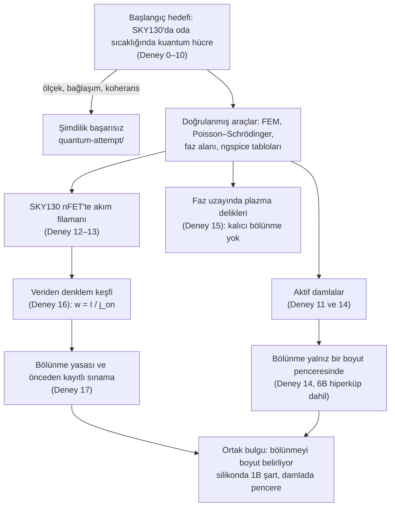

# Silikon Mitozu

**Standart silikon CMOS'ta (SKY130) kendiliğinden bölünen akım filamanları: parametresiz ve önceden kaydedilmiş bir bölünme yasası, aktif maddede boyuta bağlı bölünme**

Araştırma: **counfield** — <https://counfield.com/> · English: [README.md](README.md)

> **Durum (Ekim 2026).**
> - Bu depodaki bütün sonuçlar **model ve benzetim** sonucudur; hiçbiri henüz silikon üzerinde ölçülmedi.
> - Proje, standart 130 nm süreçte *kuantum* bir aygıt elde etme hedefiyle başladı. Bu deneme **şimdilik başarısız** ve ayrı
>   bir klasörde anlatılıyor: [`quantum-attempt/`](quantum-attempt/README.md).
> - Deney başına ayrıntılı raporlar Türkçedir: `results/*/summary_*.md`. Yayın öncesi denetimde bulunan düzeltmeler, ilgili raporların
>   başındaki kutuda listelendi; özgün metinle çelişirse kutu geçerlidir.

---

## Özet

Sıradan bir silikon çipteki bir yapı, sabit bir elektriksel sürüş altında biyolojik bir hücre gibi **kendiliğinden büyüyüp bölünebilir mi?**

**Aygıt ve bölünen yapı.**
- Açık kaynaklı SkyWater SKY130 `nfet_01v8` transistörünün indirgenmiş bir modelini kullandık. Model, dökümhanenin BSIM4 model
  kartından ngspice ile türetildi; 4 K'e özgü davranış açıkça taranan varsayımlarla eklendi.
- Bu modelde eşiğin hemen altında sürülen geniş bir nFET bir **akım filamanı** oluşturur: kanal genişliğinin yalnız bir bölümünde
  açılan, yüzer gövdeli bir kilitlenme (latch).
- Drenaj bölümlere ayrılıp her bölüm beslemeye kendi balast direnciyle bağlanırsa filaman akımla **büyür, ikiye bölünür ve kız
  filamanlar yeniden bölünür**.

**Bölünme yasası.**
- Filaman, merkezindeki drenaj gerilimi iletken durumun var olabildiği en düşük gerilime, $V_\text{down}$'a indiğinde bölünür.
- Yalıtılmış bir filaman için bu, kapalı biçimli bir bölünme genişliği verir: $w_s = 2\lambda\ln[\lambda/(\lambda-\lambda_c)]$.
  Sabitler aygıt modelinden gelir; hiçbir parametre veriye uydurulmadı.
- Öngörüler, onları sınayan benzetimlerden önce kaydedildi. Temiz protokolde (yük $R_L$ = 5 kΩ) gözlenen 22 bölünmede merkez–kenar
  drenaj düşüşünün öngörülen paya oranı 1,001 ± 0,069 (aralık 0,89–1,11). Çok farklı iki aygıt parametre setinde oran 0,98 ± 0,13
  (9 bölünme). Daha sert yük ve çok düşük gövde sızıntısı bölünmeyi geciktiriyor (§3.1'de incelenen 63 bölünmenin tamamı var).
- 14 temiz koşunun ilk bölünme genişlikleri kapalı formu %9 RMS hatayla izliyor. Eşiğe yakın bir öngörü tutmadı: λ_c'nin %1 üstündeki
  λ = 36 µm'de filaman bölünmedi.
- Tek serbest sabitle yapılan uydurma kuramsal değerin 1,01 katını veriyor. Kör sembolik regresyon benzer kısalıkta bir yasa bulamadı.

**Boyut.**
- Aynı "büyüme–bölünme" yarışı, kimyasal olarak aktif damlaların sürekli ortam modelinde $d = 2 \dots 6$ boyutta incelendi;
  gerçek bir 6B Cahn–Hilliard hiperküpü de buna dahil.
- Bölünme yalnız bir **boyut penceresi** içinde gerçekleşiyor ve pencere kimyasal sürüşle kayıyor.
- Silikonda bölünen geometri tek boyutlu: 2B dizilerde akım lekesi bölünmek yerine uzayıp solucana dönüşüyor.

## Araştırmanın akışı



## 1. Arka plan ve soru

Çalışmanın çıkış noktası iki gözlem oldu.
- **(i) Kararlı, boyutu belirli filamanlar.** Bistabil (S biçimli) akım–gerilim karakteristiklerinin yarıiletkenlerde akım
  filamanları oluşturduğu biliniyor (Schöll; Hüpper ve ark.). Yük direnci gibi *küresel* bir kısıt, genişliği akımla büyüyen tek
  bir filaman seçer.
- **(ii) Kendini çoğaltan lekeler.** *Yerel* bir inhibitörü olan tepkime–difüzyon sistemleri kendini çoğaltan lekeler gösterir
  (Pearson 1993).

Soru: Standart bir CMOS yerleşimi yerel inhibitörü sağlayabilir mi; böylece silikondaki bir akım filamanı bölünen bir hücre gibi
davranır mı? Davranıyorsa bölünme boyutunu ne belirler?

## 2. Model

**Aygıt düzeyi.** Deney 12–13; `experiments/exp12_filament/`.
- **Tablolar.** Resmî SKY130 `nfet_01v8` kartı (tt köşesi, BSIM4.5) ngspice ile benzetildi. Drenaj akımı $I_d$, darbe
  iyonlaşması akımı $I_\text{sub}$ ve $V_T$, $(V_{gs}, V_{ds}, V_{bs})$ üzerinde tablolandı.
- **Varsayılan 4 K fiziği.** 4 K'e özgü davranış açık ve taranan varsayımlarla eklendi: eşik altı eğimi, darbe iyonlaşması çarpanı,
  gövde diyodunun açılma gerilimi, donmuş kuyu sızıntısı $g_\text{sub}$, yanal gövde tabaka direnci.
- **Yerel bistabilite.** Genişliği $dy$ olan her bölümün gövde potansiyeli $V_b$ şu denkleme uyar:
  $C_b\,\dot V_b = \kappa\,\partial_y^2 V_b + F_{ii}\,M(V_{D})\,j_d(V_b) - j_0 e^{(V_b - V_\text{on})/V_s} - g_\text{sub}V_b$.
  Yerel drenaj gerilimi $V_D$'nin belli bir aralığında bu denklemin düşük ve yüksek (kilitli) iki kararlı durumu vardır.
- **Referans aygıt seti** (`law.BASE`): eşik altı eğimi SS = 20 mV/dek; darbe iyonlaşması çarpanı $F_{ii}$ = 10; kapı aşırı
  sürüşü $V_{gs} - V_T$ = −0,1 V; gövde diyodu açılması $V_\text{on}$ = 1,05 V, üstel ölçek gerilimi $V_s$ = 5 mV; donmuş kuyu
  sızıntısı $g_\text{sub}$ = $10^{-13}$ A/(V·µm). Evrensellik için iki set daha: U1 (SS = 30 mV/dek, $V_s$ = 10 mV, $F_{ii}$ = 3,
  $g_\text{sub}$ = $10^{-12}$) ve U2 (SS = 15 mV/dek, $F_{ii}$ = 30).

**İnhibitör.** Deney 13 ve 17. Drenaj dirençli bir hattır ($r_D$, Ω/µm). Hattın her noktası ortak düğüm $V_c$'ye dağıtık bir
balastla ($r_v$, Ω·µm) bağlıdır. Düşüş $u = V_c - V_D$ şu denkleme uyar:

$$u'' = \frac{u}{\lambda^2} - r_D\, j_d(y), \qquad \lambda = \sqrt{r_v / r_D}.$$

**Küresel kısıt.** $V_c = V_{DD} - R_L I$. Filamanın cepheleri eşit alan (Maxwell) gerilimi $V_M$'de durağandır.

## 3. Ana sonuç: bölünme yasası


**Şekil 1 — Mekanizma** (etiketler İngilizce).
- **(a) Aygıt.** Drenajı dirençli bir hat ($r_D$) olan ve her bölümünde bir balast direnci ($r_v$) bulunan geniş bir nFET. Turuncu
  bölge, genişliği $w$ olan bir akım filamanı.
- **(b) Genişlik boyunca drenaj gerilimi**; λ = 60 µm ve $r_D$ = 10 Ω/µm için hat çözücüsüyle hesaplandı. Filaman akım çektiği için
  drenaj gerilimi en çok **merkezinde** düşer; kenarlar (cepheler) $V_M$'dedir.
  - Mavi: genişliği 0,6 $w_s$ olan bir filaman. Merkezi $V_\text{down}$'ın üstünde kalır; filaman kararlıdır.
  - Kırmızı: kritik genişlik $w_s$ = 108 µm. Merkez $V_\text{down}$'a ulaşır ve kilitli durum orada artık var olamaz. Merkez söner,
    filaman ikiye bölünür.
- **(c) Benzetimde bir soy ağacı** (referans aygıt, λ = 60 µm, $r_D$ = 10 Ω/µm, W = 600 µm, temiz protokol; koşu `H_lam60_s1`).
  - Tek bir filaman I ≈ 80 µA'de doğar ve akımla orantılı genişler.
  - w = 120 µm'de bölünür; yalıtılmış filaman için öngörü 108 µm.
  - Kız filamanlar birbirinden uzaklaşır, büyür ve her biri yeniden bölünür: 105 µm'de ve 126 µm'de (1 → 2 → 4 filaman).
  - Üç bölünmede, gerçek filaman düzeniyle hesaplanan ölçüt Δu/($V_M - V_\text{down}$) = 1,11, 0,94 ve 0,92 veriyor. Son bölünme
    yalıtılmış formülün söylediğinden geç geliyor, çünkü komşu filaman ve aygıt ucu merkezdeki düşüşü azaltıyor.
- **(d) 14 temiz ilk bölünme ve kapalı form.** Referans set $r_D$ = 5, 10 ve 20 Ω/µm'de; U1 ve U2 setleri $r_D$ = 10 Ω/µm'de.
  Ortamda ikiden fazla filaman varken gerçekleşen ilk bölünmeler gösterilmedi (tek örnek: λ = 2,5 $\lambda_c$'deki U2, %18 geç
  bölünüyor).

**Türetme.** Mikrometre başına $j_\text{on}$ akım taşıyan, genişliği $w$ olan bir filamanda merkez–kenar düşüşü
$\Delta u = \tfrac{1}{2} r_v j_\text{on}\,(1-e^{-w/2\lambda})^2$'dir. $\Delta u = V_M - V_\text{down} \equiv \Delta V_c$ koşulu:

$$\boxed{\,w_s = 2\lambda \ln\frac{\lambda}{\lambda-\lambda_c},\qquad \lambda_c=\sqrt{\frac{2\,(V_M-V_\text{down})}{r_D\, j_\text{on}}}\,}$$

- **Eşik:** $\lambda \le \lambda_c$ iken bölünme olmaz.
- **Alt sınır:** $\lambda \gg \lambda_c$ için bölünme genişliği $2\lambda_c$'ye yaklaşır.
- **Periyodik diziler** (periyot $P$), aynı ölçütten: $\Delta u = r_v j_\text{on}(\cosh a - 1)/(\cosh a + \sinh a \coth b)$, burada
  $a = w/2\lambda$ ve $b = (P-w)/2\lambda$. Bu biçim türetildi ama bu çalışmada **sınanmadı**.
- **Topluluk:** toplam filaman genişliği $w_\text{top} = I/j_\text{on}$. Filaman sayısı basamak basamak, kabaca
  $N \approx I/(0{,}75\,j_\text{on} w_s)$ ile artıyor; bu çizgi Şekil 2d'de çizilmiş bir kılavuzdur, uydurma değildir.

**Referans aygıt setinin sabitleri:**

| büyüklük | değer | çapraz kontrol |
|---|---|---|
| $V_M$ | 0,8018 V | eşit alan kuruluşu, Deney 12 |
| $V_\text{down}$ | 0,7855 V | Deney 13'te gözlenen bölünmede merkez $V_D$: ≈ 0,785 V |
| $\Delta V_c$ | 16,27 mV | |
| $j_\text{on}$ | 2,569 µA/µm | Deney 16'da veriden uydurulan: 2,55 ± 0,03 |
| $\lambda_c$ | 50,3 / 35,6 / 25,2 µm | $r_D$ = 5 / 10 / 20 Ω/µm için |

### 3.1 Sınama

Öngörüler ilgili koşulardan önce kaydedildi (`results/exp17/predictions*.json`). Mekanizma denetimi, saptanan her bölünmede
merkez–kenar düşüşünü gerçek filaman düzeniyle (komşular ve aygıt uçları dahil) hesaplıyor ve $\Delta V_c$'ye bölüyor. İncelenen 63
bölünmenin tamamı, protokole göre (`results/exp17/mechanism.json`; ± bölünmeler arası standart sapma):

| protokol | bölünme | Δu / ΔV_c |
|---|---|---|
| temiz: $R_L$ = 5 kΩ, normal uyumsuzluk | 22 | **1,001 ± 0,069** (0,89–1,11) |
| temiz, uyumsuzluk × 0,1 | 2 | 1,03 |
| sert yük: $R_L$ = 2 kΩ (veri dosyalarında "hızlı" adıyla; adım süresi yine 1 s) | 22 | 1,038 ± 0,062 |
| sert yük, uyumsuzluk × 0,1 | 7 | 1,14 ± 0,07 |
| aygıt setleri U1, U2 ($R_L$ = 5 kΩ) | 9 | **0,979 ± 0,133** |
| çok düşük sızıntı, $g_\text{sub}$ = $10^{-15}$ | 1 | 2,60 |

| sınama | sonuç |
|---|---|
| İlk bölünme genişliği, 14 temiz koşu (referans set: $r_D$ = 10'da 8, 20'de 2, 5 Ω/µm'de 1; U1, U2: 10 Ω/µm'de 3) | ortalama hata +%1,6, RMS %9,1 |
| Eşik altı: λ = 30 µm ($\lambda_c$ = 35,6 µm) | öngörüldüğü gibi bölünme yok |
| Eşiğin hemen üstü: λ = 36 µm | **ıskalama.** Öngörü w = 322 µm'de bölünmeydi; filaman 350 µm'ye büyüdü ve bölünmedi. Eşik yakınında $w_s$ ıraksar: $\Delta V_c$ %2,3 büyük olsaydı λ = 36 µm eşiğin altında kalırdı. |
| Toplam genişlik $w_\text{top} = I/j_\text{on}$ | oran 1,00–1,02 (referans ve U setleri); çok düşük sızıntıda 1,03–1,23 |
| Tek serbest sabit $k$ ($\lambda_c = k/\sqrt{r_D}$), 11 referans set koşusuna uyduruldu | $k$ = kuramın 1,010 katı, birini dışarıda bırak (LOO) hatası %8,2; parametresiz biçim aynı koşularda %7,75 |
| Rakip biçimler | kuvvet yasası $A\lambda^a r_D^b$: LOO %11,5. Kör GP sembolik regresyon (gplearn): 32–70 düğümlü ifadeler, eğitim hatası %4,3–11 (LOO yok), kısa yasa yok |
| Birim testi | `tests/test_exp17.py`: kapalı form ile ayrık hat çözücüsü %1 içinde (λ = 60 µm, $r_D$ = 10 Ω/µm) |


**Şekil 2 — Deney 17 özeti.**
- **(a)** Bütün ilk bölünmelerle evrensel eğri. Dolu işaret: bölünürken ortamda tek filaman; boş: iki; soluk: $R_L$ = 2 kΩ.
- **(b)** Normal uyumsuzluklu her bölünmede Δu/ΔV_c histogramı: temiz (n = 22), U1/U2 (n = 9), sert yük (n = 22).
- **(c)** Şekil 1c'deki soy ağacı.
- **(d)** Bütün temiz koşularda filaman sayısı, boyutsuz akım $I/(j_\text{on} w_s)$'e karşı. Kesikli çizgi kılavuzdur, uydurma değil.
- **(e)** Neredeyse düzgün bir aygıt (uyumsuzluk × 0,1, λ = 80 µm).
  - Üç filaman $V_{DD}$ ≈ 1,56 V'ta birlikte doğuyor ve yaklaşık 101, 302 ve 501 µm'ye yerleşiyor: eşit aralıklı, Turing benzeri.
  - Biri $V_{DD}$ ≈ 5,5 V'ta bölünüyor. O anda gerçek düzenle hesaplanan merkez–kenar düşüşü 16,30 mV ($\Delta V_c$ = 16,27 mV);
    yalıtılmış filaman formülü 23,7 mV verirdi.
  - λ = 40–60 µm'lik neredeyse düzgün aygıtlarda üçlü, $V_{DD}$ = 5,6 V'a kadar bölünmedi.
- **(f)** Geçerlilik sınırı: çok düşük sızıntı ($g_\text{sub} = 10^{-15}$; gövdenin boşalma süresi $c_b/g_\text{sub}$ ≈ 1 s).
  - Standart adım başına 1 s ile filaman 541 µm'ye büyüyor ve bölünmüyor.
  - 30 kat yavaş taramada 225,5 µm'de, yarı statik öngörünün (88 µm) 2,6 katında bölünüyor.

### 3.2 Silikonda "mitoz" tek boyutlu geometri gerektiriyor

2B parmak bölümlerinden oluşan, 2B drenaj tabakası ve dağıtık balastı olan bir diziyi de benzettik (`spatial2d.py`; λ = 64 µm,
yalıtılmış disk için öngörülen kritik yarıçap $R_c$ = 71 µm). Koşularda ya yansıtıcı duvarlar (T64, V64_small) ya da tasarlanmış
bir çekirdeklenme noktalı periyodik sınırlar (P64) kullanıldı.
- **Bölünme yerine uzama.** Akım lekesi yuvarlak büyüyor ve öngörülen kritik yarıçapı yaklaşık %3 (T64) ve %10 (P64) aşıyor. Sonra
  uzuyor: önce dambıl, sonra kıvrımlı bir şerit.
- **Merkez sönmüyor.** Merkez hiçbir zaman $V_\text{down}$'a inmiyor, çünkü uzama merkezdeki inhibisyonu hafifletiyor. 15,2 mA'e
  kadar bölünme yok (P64). Leke etiketleyici geç P64 durumlarında iki parça bildiriyor; periyodik sınırlar birleştirilince bunların
  tek şerit olduğu görülüyor.
- **Uyarı.** Bu 2B koşularda gerilim adımlarının yalnız %12–44'ü yineleme sınırından önce durağan durum toleransına ulaştı. Durumlar
  düzgün evriliyor, ama 2B taramalar 1B'dekiler kadar yarı statik değil; 2B sonuç daha zayıf bir kanıt.


**Şekil 3 — Periyodik sınırlı ve tasarlanmış çekirdeklenme noktalı 2B dizi** (P64, λ = 64 µm): artan $V_{DD}$'de gövde potansiyeli.
- Yuvarlak leke önce dambıl, sonra şerit oluyor; bölünmüyor.
- Son panellerde sol kenardaki parça, aynı şeridin periyodik sınırdan sarılan sağ ucudur.

> **Tasarım ilkesi.** Bölünme, iletken bölge tek boyuta, yani geniş bir transistörün genişliğine hapsedildiğinde oluyor. 2B'de
> uzama kazanıyor.

### 3.3 Önerilen SKY130 test yapısı (yanlışlanabilir)

- **Aygıt:** `nfet_01v8`, W ≈ 600 µm, L = 0,15 µm, $V_{gs} \approx V_T - 0{,}1$ V. Drenaj ≈ 5 kΩ üzerinden ya da akım kaynağıyla
  yavaşça taranır.
- **Drenaj hattı:** 1,28 µm genişliğinde `li1` şeridi (12,8 Ω/□ → 10 Ω/µm).
- **Balast:** λ = 60 µm için 10 µm'lik bölüm başına 3,6 kΩ; `res_high_po` (~300 Ω/□) ya da `res_xhigh_po` (2000 Ω/□). Tabaka
  değerleri [SkyWater PDK belgelerinden](https://skywater-pdk.readthedocs.io/en/main/rules/device-details.html).
- **Dizi:** aynı kalıpta λ = 30, 45, 60, 90 µm ve balastsız bir kontrol aygıtı. $\lambda_c$'nin birkaç yüzde yakınındaki λ
  değerlerinden kaçınılmalı: orada $w_s$ ıraksar ve sabitlere çok duyarlıdır.
- **Öngörü:** 30 µm'de bölünme yok; diğerlerinde $w_s = 2\lambda\ln[\lambda/(\lambda-\lambda_c)]$; bölüm akımlarında görülen,
  basamak basamak artan filaman sayısı.
- **Parametresiz sınama:** üç sabitin üçü de tek bir referans aygıtta ölçülebilir:
  - $V_M$: balastsız bir filamanın kenetlendiği gerilim;
  - $V_\text{down}$: dar bir aygıtta histerezisin alt kenarı;
  - $j_\text{on}$: plato boyunca $dI/dw$.

## 4. Bölünme boyuta bağlı (aktif damlalar, 6B hiperküpe kadar)

Deney 14 (`results/exp14_dimension/`), kimyasal olarak aktif Cahn–Hilliard damlalarını (Zwicker ve ark. 2017 modeli) sürekli
boyut $d$ için inceliyor.

**Yöntemler.**
- $(z, r)$ yarı düzlemine tam bir O(d−1) simetrik indirgeme; Laplasyen $\partial_{zz} + \partial_{rr} + (d-2)r^{-1}\partial_r$.
- **Gerçek bir 6B hiperküpe** kadar kullanılan yalın bir Kartezyen çözücü (16⁶ = 16,8 milyon nokta).
- Kimyasal potansiyelle yazılmış, doğrusal olmayan keskin arayüz kuramı.

**Sonuçlar.**
- **Geometri.** Pasif Rayleigh–Plateau kopma bandı $kR < \sqrt{d-2}$. d = 3–6 için ölçülen eşikler 0,962 / 1,372 / 1,686 / 1,949;
  kuram 1 / 1,414 / 1,732 / 2.
- **Bölünme penceresi.** Aktif damlalar yalnız $2 < d \lesssim d_c(\Delta\nu)$ aralığında bölünüyor:

  | kimyasal sürüş Δν | bölünen boyutlar |
  |---|---|
  | −0,004 | 2,25–2,5 |
  | −0,001 (Zwicker parametreleri) | 2,3–3,5 |
  | +0,004 | 2,5–4 |
  | +0,012 ve +0,022 | 6B bölünüyor |

  Pencerenin altında damla bir şeride dönüşüyor. Üstünde ise çekirdek, damla bölünemeden spinodalin altına düşüyor ve damla
  **içi boş bir sıvı kabuğa** dönüşüyor.
- **3B ile 6B.** *Ayrık* sürüş pencerelerinde bölünüyorlar (eksenel koşular `axi/Z_*.json`):
  - 3B, Δν = −0,003…+0,004'te bölünüyor; −0,004'te içi boş kabuk oluyor, +0,012 ve +0,022'de olay yok.
  - 6B yalnız Δν ≥ +0,012'de bölünüyor; −0,001…+0,008'de kabuk oluyor.
- **Doğrulama.**
  - İndirgeme tam 3B Kartezyen bölünmeyi yeniden üretiyor: ilk bölünme t = 1850'ye karşı 1750–2000; kız yarıçapları 9,7'ye karşı 9,9.
  - Damla büyürken (t ≤ 40) 6B hiperküple %2,5 içinde uyuşuyor.
  - Doğrusal olmayan kuram 2B damla yarıçaplarını %1–6 içinde veriyor (oran 0,99–1,06; 5 damla). Doğrusal etkin damla kuramı
    vermiyor (oran 0,70–0,77; 9 damla).


**Şekil 4 — Deney 14.**
- **(a)** d = 3–6 için pasif kopma bandı, $kR$'ye karşı. Kesikli çizgiler: $\sqrt{d-2}$.
- **(b)** Δν = −0,001'de d = 2 … 6 için ilk olay: şerit, bölünme ya da içi boş kabuk.
- **(c)** $(d, \Delta\nu)$ faz diyagramı: bölünme penceresi ve 3B/6B karşılaştırması.
- **(d)** Pencerenin neden kapandığı: yoğun bir çekirdeğin var olabildiği en büyük yarıçap ile zayıflayan uzama hızı.
- **(e)** Tam Kartezyen koşulara karşı 3B doğrulama.
- **(f)** Gerçek 6B hiperküp ile O(5) indirgemesi.

**İlgili deneyler.**
- **Deney 15.** Doğrulanmış bir parçacık-hücre (PIC) koduyla 6B faz uzayında çarpışmasız bir plazma. Elektron delikleri 1B'de
  birleşiyor, 2B ve 3B'de parçalanıp sönüyor. Kalıcı bölünme görülmedi.
- **Deney 16.** Proje verisinden PySINDy ile denklem keşfi.
  - Temiz veriden Gray–Scott denklemlerini ve Hartree–Fock sıkıştırılabilirliğini buluyor.
  - BSIM4 darbe iyonlaşması ancak ikinci denemede, BSIM4'ün etkin drenaj gerilimi aday kütüphaneye eklendikten sonra bulundu; ilk
    deneme 0/90.
  - %1 gürültüde yöntem başarısız (Gray–Scott'ta sınandı).
  - Diğer hedefler (gövde etkisi, FEM yakınsaması) yalnız yaklaşık bulundu ya da hiç bulunamadı.

## 5. Kuantum denemesi (şimdilik başarısız)

Asıl hedef, standart 130 nm süreçte oda sıcaklığında kuantum rejimiydi (Coulomb blokajı, kübit). Benzetimlerimize göre bu
ulaşılabilir değil:
- gereken ada boyutu 0,13–0,39 nm, en küçük kapı ise 150 nm (yaklaşık 380–1150 kat);
- 210 nm'lik poly aralığında tünel bağlaşımı yaklaşık $10^{-29}$;
- 300 K'de polarizasyon en fazla 0,74, kapı doğruluğu en fazla 0,78.

Geri çekilen kazara kuantum noktası öngörüsü ve eksik kriyojenik veri de orada belgelendi. Tam anlatım:
[`quantum-attempt/README.md`](quantum-attempt/README.md).

## 6. Sınırlar

- **Model, ölçüm değil.** 4 K aygıt davranışı, 300 K BSIM4 tablolarından ve taranan varsayımlardan yapılan bir dış kestirim.
  Modelde olmayanlar: öz ısınma, tuzak kinetiği, parazitik bipolar transistör ve kaynak tarafı direnci.
- **Sürüş ve yük.** Bölünme yasası yarı statik bir tarama varsayar.
  - Daha sert yük ($R_L$ = 2 kΩ) bölünmeyi yaklaşık %4, düşük uyumsuzlukta %14 geciktiriyor.
  - Boşalma süresi adım süresiyle karşılaştırılabilir olan çok düşük gövde sızıntısı bölünmeyi geciktiriyor ya da bastırıyor.
- **Saçılma ve eşik.** Tek tek bölünmelerde ölçüt ±%7 saçılıyor (1σ, temiz protokol). Eşiğe yakın yerde öngörülen $w_s$ sabitlere
  aşırı duyarlı; λ = 36 µm öngörüsü tutmadı.
- **Sınanmamış parçalar.** Periyodik dizi formülü ve filaman sayısı kılavuz çizgisi doğrulanmadı.
- **2B sonuçlar.** 2B koşulardaki gerilim adımlarının çoğu durağan durum toleransına ulaşmadı. 2B sonuç (bölünme yok), 1B
  sonuçlardan daha zayıf bir kanıt.
- **Simetrik alt uzay.** $d \ge 4$ için aktif damla sonuçları O(d−1) simetrik indirgemeden geliyor. İndirgeme 3B'de ve yalnız büyüme
  evresinde 6B hiperküpe karşı doğrulandı. İlk olaydan sonraki simetri kıran kipler kapsamı dışında.
- **Kuantum değil.** Burada raporlanan her şey klasik, disipatif desen oluşumu.

## 7. Yeniden üretilebilirlik

- **Python paketleri:** Python 3.11; çekirdek için `requirements.txt`, sembolik regresyon için `requirements-optional.txt`.
- **Aygıt tabloları:** ngspice 44.2 (WSL/Debian altında) ve SkyWater `sky130_fd_pr` modelleri. Tablolar
  `experiments/exp12_filament/spice/` içinde hazır. Oradaki `.cir` dosyaları üretildikleri andaki mutlak yolları içeriyor;
  `spice_tools.py` bulunulan konum için yenilerini yazar.
- **3B FEM kontrolleri:** FEniCSx/dolfinx yalnız çapraz kontrol için kullanıldı.

```bash
pip install -r requirements.txt
pytest -q                                                 # 68 test
python experiments/exp17_silicon_split/law.py             # sabitler ve öngörüler (predictions_recomputed.json'a yazar)
python experiments/exp17_silicon_split/run.py 2 r5k       # temiz protokol: 2 süreçle her biri ~5-7 dk süren 17 koşu
python experiments/exp17_silicon_split/mechanism_check.py
python experiments/exp17_silicon_split/figures17.py       # Şekil 2 ve analysis.json
python experiments/exp17_silicon_split/figures2d.py       # runs2d/*.npz'den 2B şekiller
python experiments/exp14_dimension/figures.py             # axi/*.npz'den Şekil 4
python docs/make_mechanism_figure.py                      # Şekil 1
```

- **`run.py` argümanları** `[nproc] [mode]`; beş kip var: `''` (A–D koşuları, $R_L$ = 2 kΩ), `r5k` (temiz protokol, E–H koşuları),
  `univ` (U1, U2), `nomax` ve `slow` (çok düşük sızıntı). Hepsi birlikte `results/exp17/runs/` içindeki 40 koşuyu üretir.
- **`law.py`**, önceden kaydedilmiş `predictions.json`'ın üzerine hiçbir zaman yazmaz; yeniden hesap `predictions_recomputed.json`'a
  gider.
- **Ara kayıtlar.** JSON olmayan şekil girdileri depoda: `results/exp14_dimension/axi/*.npz` ve `hyper6d_slice.npy` (Şekil 4),
  `results/exp17/runs2d/*.npz` (2B şekiller). Diğer ara kayıtlar (yaklaşık 80 MB, çoğu Deney 15) sürüm denetiminde değil;
  benzetimler yeniden koşularak üretilir, örneğin `experiments/exp15_phase_space/run.py`.

## 8. Depo haritası

| yol | içerik |
|---|---|
| `src/qcell/` | çözücüler: aktif Cahn–Hilliard (Kartezyen ve eksenel, gerçel d), keskin arayüz kuramları, FEM, Schrödinger, 1B MOS, elektron gazı |
| `experiments/expN_*/` | her deney için bir klasör (betikler) |
| `results/expN*/` | veri (JSON/CSV), şekiller, raporlar (`summary_*.md`) |
| `research/` | hipotez tablosu, yol haritası, model varsayımları |
| `quantum-attempt/` | kuantum denemesi ve neden şimdilik başarısız olduğu |
| `docs/` | mekanizma şekli ve betiği |
| `data/sky130_models/` | SkyWater model kartları (Apache-2.0, bkz. `NOTICE.md`) |
| `README.md` | bu sayfanın İngilizce sürümü |

## 9. Atıf ve lisans

[`CITATION.cff`](CITATION.cff) dosyasındaki biçimde atıf yapınız:

> counfield (2026). *Silicon Mitosis: self-dividing current filaments in SKY130 silicon and dimension-dependent division in active matter.* <https://github.com/berkmec/silicon-mitosis>

- **Kod ve metin:** MIT lisansı (bkz. `LICENSE`).
- **Üçüncü taraf SkyWater model dosyaları:** Apache-2.0 (bkz. `NOTICE.md`).

Kaynakça için İngilizce [README.md](README.md#references) dosyasına bakınız.
