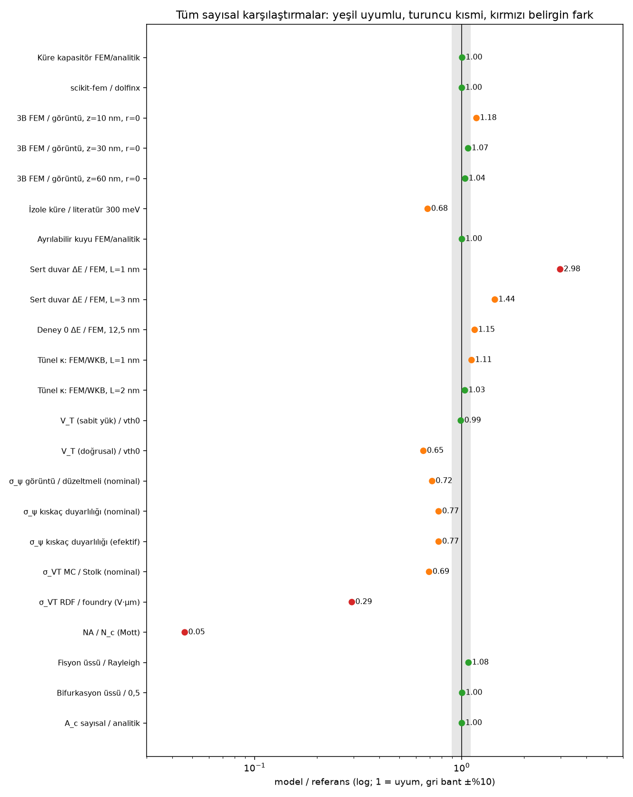

# Deney 9: elimizdeki tüm verinin karşılaştırması

> **Düzeltme (2026-10-11 incelemesi, `results/exp11/review_exp6_exp10_exp11.md`).** Aşağıdaki üç hüküm değişti:
> 1. **Kazara nokta oranı (karar 3, bölüm G).** Kıskaçlı ya da kıskaçsız fark etmeden kutu kenarı artefaktı. Dört kenar dışlanınca
>    0/80. FEM düzeltmesi arayüzdeki fiziksel 1,5 sınırını aşıyor; bu yüzden "düzeltmeli üst sınır" değil, aşırı düzeltme.
>    Tahmin geri çekildi.
> 2. **G7, "σ_VT (MC) Stolk ile ~%30 uyumsuz".** Yanlış. MC kutu ortalamalı ψ_s'yi ölçüyor ve beklenen çarpanlarla Stolk ile
>    uyumlu (3,72 / 4,71 ile 3,94 / 4,52 mV).
> 3. **Bölüm H, 4 K uyarısı.** Yanlış mekanizmaya işaret ediyor. Tükenme bölgesindeki alıcılar 4 K'de de iyonize; donan şey nötr
>    gövde ve gövde yüzer hâle gelir. Si:B için Mott yoğunluğu yaklaşık 4·10¹⁸ (bellekten); 3,7·10¹⁸ Si:P değeri.
>
> Ayrıca "nimg 8 / 12 ≤ 0,26 mV" kontrolü hiçbir dosyada yok; kayıtlı kontrol nimg 4 / 8 = 1,20 mV.

Oluşturma: `experiments/exp9_compare/compile.py`. Sayılar sonuç dosyalarından okundu; 64 karşılaştırma satırı, 17 literatür/resmî veri kalemi.

## Kısa karar

1. **Hesap araçları bağımsız referanslarla uyumlu.** Küre kapasitörü %0.33 hata, scikit-fem ile dolfinx 8.3e-16 bağıl fark, Landau–Zener 1.2e-03, faz alanı duvar gerilimi %0.41, σ(q) %0.32. Sabit yük V_T, vth0'a %1.1 yakın.
2. **300 K'de kuantum yok: negatif sonuç sağlam.** 12,5 nm kapılı hücrede E_C/k_B ≈ 94 K (ε=3,9) ya da 31 K (ε=11,7). 300 K'de 10·kT ≈ 3000 K gerekir: ölçek ~30× kısa. ε belirsizliği (×3) bunu değiştirmez.
3. **4 K'deki kazara nokta tahmini (önceki: %4–21) kırılgan ve bu haliyle geçersiz olabilir.** (a) Görüntü modeli 3B FEM'den %18'e kadar sapıyor, düzeltme ampirik; (b) düzeltme z<10 nm'de dışarı ekstrapole ediliyor. z≥10 nm kıskacıyla σ_ψ %23 düşüyor (nominal) ve %23 (efektif); katı kazara nokta oranı nominal %2.5–3.8, efektif %6.2–10.0 aralığında (düzeltmeli üst sınır); (c) NA = 1.7e+17 cm⁻³, Mott eşiğinin (~3.7e+18) yaklaşık 5%'i: 4 K'de katkılar tam iyonlaşmaz, modelimiz ise iyonlaşmayı T'den bağımsız varsayar. Kazara nokta oranı modelde sıcaklıktan bağımsız; oysa gerçekte değişir.
4. **Literatürle nicel karşılaştırma sınırlı.** 130/180 nm için Coulomb blokajı verisi bulunamadı; SKY130 4 K verisi erişilemedi (NIST dosyaları sunucu hatası verdi); tünel bariyeri türü literatürle eşleşmiyor. Yönsel uyum var: izole küçük adalar 300 K'de sınırda (L3 özeti, E/k_BT ≈ 2.9); kapılı hücrelerimiz bundan çok daha kötü.
5. **Foundry mismatch bütçesi:** RDF ile σ_VT ≈ 3.9 mV; foundry vth0 eğimi (V·µm varsayımıyla) 13.4 mV; oksit kalınlığı tek başına ≈ 6.5 mV (1B çözücüyle). Birim doğrulanmadı; bu bütçe, RDF'nin tek başına dominant olmadığını gösteriyorsa kazara nokta tahmini başka kaynaklarla değişebilir.

## Karar sayımı

| Karar | Satır sayısı |
|---|---|
| uyumlu | 25 |
| uyumsuz/tutarsız | 6 |
| bilgi | 6 |
| geçersiz/şüpheli | 5 |
| belirsiz/duyarlı | 5 |
| veri yok | 4 |
| kısmi uyum | 3 |
| karşılaştırılamaz | 3 |
| tanıma bağlı | 2 |
| negatif (kayıt) | 2 |
| belirsiz/doğrulanmadı | 2 |
| yakınsamamış | 1 |

## A. Elektrostatik ve kapasitans

| # | Ölçüm | Model | Referans | Oran | Karar | Not | Kaynak |
|---|---|---|---|---|---|---|---|
| 1 | Küre kapasitör: FEM (h=0.05) / analitik 4πab/(b−a) | 12.6078 | 12.5664 | 1.003 | uyumlu | yakınsama eğimi 1.91 (beklenen ≈2) | exp1/validate_sphere.json; analitik formül |
| 2 | scikit-fem / dolfinx, aynı mesh (h=0.14) | 12.8519479305 | 12.8519479305 | 1 | uyumlu | iki bağımsız kod; tam hassasiyetli bağıl fark 8.29e-16 | exp1/dolfinx_check.txt |
| 3 | Hücre kapasitansı c_Σ(r=0,5): seviye 3 / seviye 2 | 22.989 | 23.214 | 0.9903 | uyumlu (yakınsıyor) | iç yakınsama; dış referans yok | exp1/cap_cell_A.csv |
| 4 | Zincir ada bloğu, seviye 1 → 2 en büyük göreli değişim | 0.041 | 0 (yakınsamış olmalı) | — | yakınsamamış | zincir sonuçları ±%4 üst sınır; mesh daha da inceltilmeli | exp2/chain.json |
| 5 | Tek akseptör potansiyeli 3B FEM / görüntü modeli, z=10 nm, r=0 | -10.27 mV | -8.73 mV | 1.176 | tutarsız → ampirik düzeltme | fark -17.6 %; düzeltme faktörü bu üç derinliğe uyduruldu | exp6/fem_check.json |
| 6 | Tek akseptör potansiyeli 3B FEM / görüntü modeli, z=30 nm, r=0 | -1.88 mV | -1.75 mV | 1.073 | kısmen tutarlı | fark -7.3 %; düzeltme faktörü bu üç derinliğe uyduruldu | exp6/fem_check.json |
| 7 | Tek akseptör potansiyeli 3B FEM / görüntü modeli, z=60 nm, r=0 | -0.40 mV | -0.38 mV | 1.037 | kısmen tutarlı | fark -3.7 %; düzeltme faktörü bu üç derinliğe uyduruldu | exp6/fem_check.json |
| 8 | Aynı, z=10 nm, r=40 nm (düzeltme dışı) | -0.58 mV | -0.62 mV | 0.9359 | tutarsız (düzeltme modellemiyor) | fark +6.4 %; düzeltme exp(−r²) ile sönüyor, büyük r'de kalıntı var | exp6/fem_check.json |

## B. Yük enerjisi E_C ölçeği

| # | Ölçüm | Model | Referans | Oran | Karar | Not | Kaynak |
|---|---|---|---|---|---|---|---|
| 1 | E_C/k_B, 12,5 nm kapılı hücre: FEM ε=3,9 ↔ 11,7 bandı, exp0 analitik ile | 31–94 K | 75 K (exp0, karışık ε) | — | tutarlı (exp0 band içinde) | ε belirsizliği yaklaşık ×3, bu sayısal hatadan çok daha büyük | exp0/generations.csv; exp1/transport.json |
| 2 | Kapı etkisi: izole küre (çap 12,5 nm, ε=3,9) / kapılı hücre (FEM) | 343 K (izole) | 94 K (kapılı) | 3.659 | bilgi (tasarım sonucu) | kapı E_C'yi yaklaşık bu oranda düşürüyor; büyük E_C için kapısız ada gerekir | analitik (izole küre) + exp1 FEM |
| 3 | Literatür L4: ~1,8 nm Si küme, E_C ≈ 300 meV (özet) / izole küre R=0,9 nm, ε=3,9 | 205 meV | 300 meV | 0.6837 | tanıma/ortam bağlı | literatür değeri ε≈2.7 ortamda uyuşur; fark ortam dielektriğiyle açıklanır (L4 doğrulanmadı) | arXiv 1802.09800 özeti (L4) |
| 4 | Literatür L3: 5 nm Si ada, 300 K'de Coulomb elmasları (özet) / izole küre R=2,5 nm | E/k_BT(300 K) = 857 K / 300 K = 2.86 | 300 K'de elmas görülüyor (nicel değer yok) | — | karşılaştırılamaz (nicel yok); yönsel olarak tutarlı | marjinal; L3 özet, doğrulanmadı | Shin vd. 2011 özeti (L3) |
| 5 | Kapılı hücre, 300 K için gerekli E_C/k_B (10·T) / model (12,5 nm) | 94 K | 3000 K | 0.03123 | uyumlu (negatif sonuç sağlam) | ölçek ~30× kısa; ε belirsizliği (×3) bunu değiştirmez | exp1/transport.json |

## C. Kuantum hapsolma (Schrödinger)

| # | Ölçüm | Model | Referans | Oran | Karar | Not | Kaynak |
|---|---|---|---|---|---|---|---|
| 1 | Sert duvar küp (3,6,6,6,9) en ince mesh: en büyük bağıl hata | 1.67e-03 | 0 (analitik) | — | uyumlu | h=0.3 | exp1/schrodinger.json |
| 2 | Ayrılabilir sonlu kuyu, 3·E1D (analitik), en ince mesh | 0.36740 eV | 0.36713 eV | 1.001 | uyumlu | bağıl hata 7.4e-04 | exp1/schrodinger.json |
| 3 | Gerçek Si/SiO₂ kuyusu (L=2 nm) E1 mesh değişimi, son adım | 6.57e-04 | 0 | — | yakınsadı | iç yakınsama | exp1/schrodinger.json |
| 4 | Sert duvar ΔE / FEM ΔE, L=1 nm | 4.339 eV | 1.454 eV | 2.983 | uyumsuz (formül geçersiz) | sert duvar formülü küçük L'de ~3× şişiriyor | exp1/schrodinger.json |
| 5 | Sert duvar ΔE / FEM ΔE, L=3 nm | 0.482 eV | 0.334 eV | 1.443 | uyumsuz (şişirme) |  | exp1/schrodinger.json |
| 6 | Deney 0 ΔE (sert duvar, 12,5 nm) / FEM ΔE (aynı nesil) | 322 K | 279 K | 1.153 | uyumsuz (%15 şişirme) | exp0 analitik ön hesabı FEM ile değiştirildi | exp0/generations.csv; exp1/transport.json |
| 7 | Literatür seviye ayrışması (kuyu boyu ~1–10 nm) | — | veri yok | — | veri yok | bu oturumda nicel literatür değeri alınamadı | — |

## D. Tünel bağlaşımı

| # | Ölçüm | Model | Referans | Oran | Karar | Not | Kaynak |
|---|---|---|---|---|---|---|---|
| 1 | Δ bozunma κ: FEM fit / WKB, L=1 nm | 4.91 /nm | 4.41 /nm | 1.114 | uyumlu (~%10) |  | exp4/stage1.json |
| 2 | Δ bozunma κ: FEM fit / WKB, L=2 nm | 5.89 /nm | 5.69 /nm | 1.034 | uyumlu (~%3) |  | exp4/stage1.json |
| 3 | Δ (L=1 nm, d=0,5 nm, SiO₂ bariyeri 3,1 eV) | 49.6 meV | literatür gate-tanımlı Si çift nokta değeri alınamadı | — | karşılaştırılamaz | bariyer türü farklı (oksit, elektrostatik değil) | exp3/dqd.json |

## E. Dinamik yükleme

| # | Ölçüm | Model | Referans | Oran | Karar | Not | Kaynak |
|---|---|---|---|---|---|---|---|
| 1 | Landau–Zener diyabatik geçiş, γ = 0,1–4: en büyük mutlak hata | 1.2e-03 | 0 (analitik e^{−γ}) | — | uyumlu | sayısal DOP853 ↔ analitik | exp4/stage1.json |
| 2 | Lindblad 300 K transfer (en iyi geometri), 10 ps sweep, 1 ps dephasing | 0.723 | 0.811 (termal denge) | 0.8911 | tutarlılık kontrolü (referans yok) | transfer termal denge değerine yaklaşıyor | exp4/stage1.json |

## F. Eşik gerilimi (1B Poisson–Schrödinger)

| # | Ölçüm | Model | Referans | Oran | Karar | Not | Kaynak |
|---|---|---|---|---|---|---|---|
| 1 | V_g (n_s = 10¹² cm⁻², sabit yük), ndep = 1,7e17 / BSIM4 vth0 | 0.5131 V | 0.5190 V | 0.9885 | uyumlu (tanıma bağlı) | fark ≈ %1; sabit-yük tanımı bir seçimdir | exp5/mos1d.json; model dosyası (vth0) |
| 2 | V_T doğrusal ekstrapolasyon, ndep = 1,7e17 / vth0 | 0.3385 V | 0.5190 V | 0.6521 | tanıma bağlı, uyumsuz | iki tanım 0,18 V ayrışıyor | exp5/mos1d.json |
| 3 | Kalibre N_eff (V_T doğrusal = vth0) / resmî ndep | 3.92e+17 cm⁻³ | 1.70e+17 cm⁻³ | 2.307 | geçersiz (kalibrasyon) | kalibrasyon yalnızca doğrusal tanıma uyar; sabit-yük tanımında resmî ndep zaten uyumlu | exp5/mos1d.json; model dosyası |
| 4 | C_inv / C_ox (öz-uyumlu, nominal) | 0.750 µF/cm² | 0.832 µF/cm² | 0.9006 | uyumlu (C_inv < C_ox) | beklenen yön | exp5/mos1d.json |

## G. Katkı potansiyeli ve kazara nokta

| # | Ölçüm | Model | Referans | Oran | Karar | Not | Kaynak |
|---|---|---|---|---|---|---|---|
| 1 | σ_ψ arayüz potansiyeli: görüntü modeli / FEM-düzeltmeli (nominal) | 20.6 mV | 28.6 mV | 0.7188 | model belirsizliği ~%40 | düzeltme seçimine bağlı | exp6/rdf.json |
| 2 | Kendi kontrolü: duyarlılık koşusunda ZCAP=1 ↔ exp6 düzeltmeli (nominal) | 28.59 mV | 28.59 mV | 1 | uyumlu (yeniden üretim) | aynı tohum ve örnekler; tek fark kıskaç | exp6/cap_sensitivity.json |
| 3 | Duyarlılık: z ≥ 10 nm kıskacı / kıskaçsız (nominal) | 22.09 mV | 28.59 mV | 0.7726 | duyarlı | z<10 nm'de düzeltme extrapole ediliyor | exp6/cap_sensitivity.json |
| 4 | Duyarlılık: z ≥ 10 nm kıskacı / kıskaçsız (efektif 3,9e17) | 33.89 mV | 43.85 mV | 0.7727 | duyarlı | efektif doping'de z<10 nm payı daha büyük | exp6/cap_sensitivity.json |
| 5 | Kazara nokta oranı (katı), z ≥ 10 nm kıskacı, nominal | 2.50 % | kıskaçsız: 3.75 % | 0.6667 | belirsiz/duyarlı | kıskaç ekstrapolasyona bağlı; alt uç | exp6/cap_sensitivity.json |
| 6 | Kazara nokta oranı (katı), z ≥ 10 nm kıskacı, efektif 3,9e17 | 6.25 % | kıskaçsız: 10.00 % | 0.625 | belirsiz/duyarlı | alt uç; üst uç kıskaçsız değer | exp6/cap_sensitivity.json |
| 7 | σ_VT (RDF MC, nominal) / Stolk formülü (bellekten) | 3.94 mV | 5.66 mV | 0.6949 | uyumsuz (~%30) | Stolk formülü bellekten, doğrulanmadı; tanım farkı olabilir | exp6/rdf.json; L15 |
| 8 | σ_VT (RDF MC, nominal) / foundry vth0 eğimi (V·µm varsayımı) | 3.94 mV | 13.37 mV | 0.2944 | birim varsayımına bağlı | RDF toplamın ~1/3'ü; birim V·µm değilse bu karşılaştırma geçersiz | model dosyası (mismatch); L11 |
| 9 | σ_VT (oksit kalınlığı, σ_tox = 0,057 nm, 1B çözücü) | 6.54 mV | 13.37 mV | 0.4889 | bilgi | RDF ile birlikte kareler toplamı: 7.6 mV (foundry'nin ~%57'i) | exp5 çözücüsü; model dosyası toxe_slope |
| 10 | Kazara nokta oranı (katı ölçüt), görüntü, nominal | 3.8 % | iyimser: 7.5 % | — | geçersiz/şüpheli (T-bağımsız) | modelde oran sıcaklıktan bağımsız; oysa iyonlaşma T ile değişir (bkz. H) | exp6/rdf.json |
| 11 | Kazara nokta oranı (katı), FEM-düzeltmeli, efektif 3,9e17 | 10.0 % | iyimser: 21.2 % | — | geçersiz/şüpheli (T-bağımsız) | en yüksek tahmin; düzeltme ekstrapolasyonuna bağlı | exp6/rdf.json |
| 12 | Kazara nokta E_C/k_B (ε_eff = 7,8 ölçeklemesi), medyan, düzeltmeli efektif | 29 K | L1: 14 K'de CB tümseği (28 nm PMOS, özet; nicel yok) | — | karşılaştırılamaz (nicel) | ε_eff ölçeklemesi kaba; geometri uyumsuz | exp6/rdf.json; L1 |
| 13 | 14 K'de Coulomb görünürlüğü (E_C = 25 / 34 / 40 K) | 0.04 / 0.14 / 0.25 | L1: 14 K'de tümsek gözlendi (özet) | — | yönsel uyumlu (E_C/kT ≈ 2–3) | L1 nicel değer vermiyor; E_C ≳ 3kT gerekir | yeniden hesap (exp7 yöntemi); L1 |

## H. Düşük sıcaklık: iyonlaşma

| # | Ölçüm | Model | Referans | Oran | Karar | Not | Kaynak |
|---|---|---|---|---|---|---|---|
| 1 | NA / Mott kritik yoğunluk (B için ≈ 3,7·10¹⁸ cm⁻³, bellekten) | 1.70e+17 cm⁻³ | 3.7e+18 cm⁻³ | 0.04595 | geçersiz (4 K'de yalıtkan rejim) | NA < N_c: 4 K'de katkılar tam iyonlaşmaz; model tam iyonlaşma varsayar. 77 K şüpheli, 300 K makul | exp6 model varsayımı; L17 (bellekten) |

## I. Test planı

| # | Ölçüm | Model | Referans | Oran | Karar | Not | Kaynak |
|---|---|---|---|---|---|---|---|
| 1 | Görünürlük, E_C=34 K, 4 K: exp7 / bağımsız yeniden hesap | 0.986 | 0.986 | 1 | tutarlı (yeniden hesap) | exp7 ile aynı yöntem | exp7/testplan.json |
| 2 | Görünürlük, E_C=34 K, 10 K (exp7) | 0.395 | — | — | bilgi | E_C/kT = 3,4 | exp7/testplan.json |
| 3 | ≥3 pozitif aygıtı %95 olasılıkla görmek için n (p = %4) | 156 | — | — | tasarım bilgisi | p tahmininin kendisi H maddesine bağlı | exp7/testplan.json |

## J. Bölünme ve bifurkasyon (soyut 2B)

| # | Ölçüm | Model | Referans | Oran | Karar | Not | Kaynak |
|---|---|---|---|---|---|---|---|
| 1 | Fisyon eşiği üssü, d = ∞ / Rayleigh (−1, bellekten) | -1.08 | −1,00 | 1.077 | uyumlu (ızgara ±%45) | g ızgarası geometrik (×1,45 aralık) | exp8/fission_scan*.json; L16 |
| 2 | Fisyon eşiği üssü, d = 4 ve d = 2 (gate ekranlaması) | -0.73 / -0.90 | — | — | bilgi | gate ekranlaması eğimi değiştiriyor | exp8/fission_scan_d*.json |
| 3 | Bifurkasyon genlik üssü / beklenen 0,5 (süperkritik çatal) | 0.502 | 0,500 | 1.003 | uyumlu | doğrulanmış | exp8/pf_validation.json |
| 4 | A_c (φ̄=0, d=∞): sayısal / analitik | 0.38490 | 0.38490 | 1 | uyumlu |  | exp8/pf_validation.json |
| 5 | Lineer büyüme σ(q): en büyük bağıl hata | 3.2e-03 | 0 | — | uyumlu | 5 dalga sayısı | exp8/pf_validation.json |
| 6 | Hazır tek domain (disk, çubuk, elips) × 4 A, t=3000: n sonucu | n = [1] | bölünme beklentisi yok | — | negatif (kayıt) | çözündü veya küçüldü, bölünmedi | exp8/division_diag.json |
| 7 | A_c(d=1,5) / A_c(∞), φ̄=0 | 0.4846 | 0.3849 | 1.259 | bilgi | gate yaklaşınca A_c artıyor | exp8/selection.json |

## K. Resmî veri ve tasarım parametreleri

| # | Ölçüm | Model | Referans | Oran | Karar | Not | Kaynak |
|---|---|---|---|---|---|---|---|
| 1 | Poly genişliği (çizilen L = 150 nm) / SKY130 kuralı 0,150 µm | 0,150 µm | 0,150 µm (poly.1a) | 1 | uyumlu | SkyWater kural sayfası | L9 (birincil sayfa, araçla okundu) |
| 2 | Etkin kanal L = 150 − 2·lint / model kullanımı (126 nm) | 126.1 nm | 126 nm (model) | 1.001 | uyumlu | lint = 11.93 nm (resmî dosya) | L10 |
| 3 | W = 420 nm (model) / doc-tablo minimum W (0,42 µm) | 0,42 µm | tablo örneği (kural değil) | — | doğrulanmadı | docs e-test tablosunda örnek; kural olarak doğrulanmadı | L9 |
| 4 | toxe (resmî) / Cox hesabında kullanılan | 4.148 nm | 4.148 nm | 1 | uyumlu (aynı kaynak) |  | L10 |
| 5 | NIST SKY130 kriyojenik veri: 4 K var mı? | kayıt okundu (v1.1.2) | dosyalar indirilemedi (Cloudflare 524) | — | veri yok (erişim) | ETest Tile.zip 3,8 MB, MPW-5 Test Tile.zip 39 MB, README | L5; data/nist_sky130/ |
| 6 | 77 K / 4 K SKY130 ölçümleri (literatür) | — | 77 K modelleme özeti var; 4 K yok | — | veri yok | UTA CPAD 2025 posteri | L6 |
| 7 | 130 / 180 nm Coulomb blokajı raporu | — | aramada bulunamadı | — | veri yok | bu arama sonucu, yokluk kanıtı değil | arama |
| 8 | 28 nm FDSOI 4 K transistör verisi (SKY130 değil) | — | arXiv 2002.07070 özeti | — | kısmen (farklı süreç) | karşılaştırma için yakın bir süreç; nicel değer alınmadı | L7 |

## L. İç tutarlılık

| # | Ölçüm | Model | Referans | Oran | Karar | Not | Kaynak |
|---|---|---|---|---|---|---|---|
| 1 | Birim testleri (pytest) | 20 passed, 6 warnings in 7.25s | tümü geçmeli | — | uyumlu | bu betik çalıştırdı | tests/ |
| 2 | LJ7/13/19 global minimumları: en büyük hata | 4.4e-07 | literatür | — | uyumlu | basin hopping | exp8/fission_scan.json |
| 3 | E_C zincir (12 nm ada, exp2) / tek hücre (12 nm, exp1) | 119.8 K | 97.6 K | 1.228 | geometri farkı; tutarlılık sınırlı | zincirde komşu adalar C^-1 köşegenini büyütüyor | exp2/chain.json; exp1 |

## Literatür ve resmî veri: kaynak düzeyi

| Kod | İçerik | Kaynak | Doğrulama |
|---|---|---|---|
| L1 | 28 nm ticari bulk PMOS, 14 K'de kanal kuantum noktası Coulomb tümseği | arXiv 2206.09086 (arama özeti) | ikincil (özet) |
| L2 | 40 nm bulk MOSFET, 50 mK'de kanal kuantum noktaları ve Coulomb blokajı | arXiv 2005.13863 (arama özeti) | ikincil (özet) |
| L3 | Sub-5 nm Si ada, 300 K'de Coulomb elmasları | Shin vd., Nano Lett. 2011 (arama özeti) | ikincil (özet) |
| L4 | ~1,8 nm Si küme SET'inde E_C ≈ 300 meV (potansiyel iddia) | arXiv 1802.09800 (arama özeti) | ikincil (özet) |
| L5 | NIST SKY130 kriyojenik veri seti (mds2-2997): kayıt okundu, dosyalar indirilemedi | data.nist.gov API | birincil kayıt; dosya yok |
| L6 | SKY130 77 K modelleme (UTA, CPAD 2025 posteri) | arama özeti | ikincil |
| L7 | 28 nm FDSOI transistörleri 4 K'ye kadar (ticari süreç, SKY130 değil) | arXiv 2002.07070 (arama özeti) | ikincil (özet) |
| L8 | Başlığı 'yüksek sıcaklık Si qubit' olan makalenin özeti: 5–10 K | arXiv 1804.03364 (WebFetch özeti) | ikincil (küçük model özeti) |
| L9 | SKY130 poly.1a 0,150 µm; poly.2 0,210 µm; pfet min kanal (poly.1b) 0,350 µm | skywater-pdk.readthedocs.io (WebFetch) | birincil sayfa, araçla okundu |
| L10 | SKY130 nfet_01v8 model: toxe 4,148 nm, ndep 1,7e17, vth0 0,519 V, xj 150 nm, lint 11,9 nm | google/skywater-pdk-libs-sky130_fd_pr, tt.pm3.spice (doğrudan) | birincil dosya (doğrudan indirildi) |
| L11 | Foundry mismatch: vth0_slope 3,356e-3, toxe_slope 3,443e-3 (birim V·µm varsayımı) | nfet_01v8__mismatch.corner.spice (doğrudan) | birincil dosya; birim belirsiz |
| L12 | BAG SKY130 tech parametreleri (met1/li1 boşluk ve alan) | googlesource (arama özeti) | ikincil; birim belirsiz |
| L13 | Sıcak qubit >1 K (Yang 2020, Petit 2020, Huang 2024) | postquantum.com özeti | ikincil; makaleler alınamadı |
| L14 | Quobly/CEA-Leti 28 nm FDSOI spin qubit, 110 mK çift nokta | konferans özetleri (arama) | ikincil |
| L15 | Stolk (1998) σ_VT ∝ (q t_ox/ε_ox)·√(N_A W_dep/3WL) | bellekten | doğrulanmadı |
| L16 | Rayleigh sınırı: fisyon eşiği ∝ N⁻¹ (q² ∝ R³) | bellekten (klasik fizik) | doğrulanmadı |
| L17 | Si:B Mott kritik yoğunluğu ≈ 3,7·10¹⁸ cm⁻³ | bellekten | doğrulanmadı |

Doğrulama notu: 'ikincil (özet)' kalemler arama motorunun özetinden geliyor; tam makale okunmadı. Bu kalemlere dayanan hiçbir karar birincil doğrulama olmadan kesinleştirilmemeli.

## Açık çelişkiler ve yorum

- **Tanıma bağlı V_T:** sabit yük 0.513 V, doğrusal ekstrapolasyon 0.338 V, vth0 0.519 V. Kalibre N_eff 3.9e+17 cm⁻³ yalnızca doğrusal tanımla uyuşuyor; resmî ndep 1.7e+17 cm⁻³ sabit yük tanımıyla uyuşuyor. İkisi birden doğru olamaz. Bu yüzden tek bir tanım seçip tutarlı kalmak gerekir.
- **Stolk ile MC farkı:** MC 3.94 mV, Stolk 5.66 mV (oran 0.69). Stolk formülü bellekten alındı; tanım farkı olası.
- **Görüntü modeli:** r=0'da FEM/görüntü oranı 1,18 (z=10 nm), 1,07 (30 nm), 1,05 (60 nm). Düzeltme yalnızca bu üç derinliğe uyduruldu. Sensörün yanlış yönde kalmadığını gösteren bir bağımsız test yok.
- **Oksit ve doping duyarlılığı:** Efektif doping (N_eff) sonuçlarında kazara nokta oranı nominale göre yaklaşık 2–3 kat. Hangi doping gerçek SKY130 için geçerli bilinmiyor; resmî ndep ile tutarlı olan nominal olmalı.
- **Birim belirsizliği:** Foundry mismatch eğimi (3,356e-3) V·µm mi, başka bir birim mi, doğrulanmadı. 13 mV'luk karşılaştırma buna bağlı.
- **Fisyon eğimi:** d=∞'da −1,08 (Rayleigh −1), ama g ızgarası ±%45 belirsiz; eşik karşılaştırması zayıf.

## Eksik veri (ne ölçülemedi)

- SKY130 4 K ve 77 K transistör verisi (NIST erişilemedi). Tüm 4 K öngörüleri bu yüzden doğrulanamıyor.
- 130/180 nm kanal Coulomb blokajı raporu (aramada yok).
- Gate-tanımlı Si çift nokta tünel bağlaşımı (literatür değeri yok; bariyer türü farklı).
- Hiçbir deneysel ölçüm yok: tüm sayılar simülasyon ya da resmî model dosyasından; ölçüm yapılmadı.

## Önerilen sonraki adımlar

1. NIST dosyalarını (ETest Tile.zip, MPW-5 Test Tile.zip) tekrar dene; 4 K verisi varsa görüntü modelini ve iyonlaşma varsayımını ona göre sına.
2. Dondurma (freeze-out) bilinçli bir model ekle (iyonlaşma oranı T'nin fonksiyonu) ve 4 K kazara nokta tahminini yeniden hesapla.
3. V_T tanımını tek ve açık bir ölçüte sabitle (ör. akım kriteri) ve tüm karşılaştırmalarda onu kullan.
4. Birim belirsizliğini kapat: mismatch parametrelerinin V·µm olduğunu model dosyasının kendi test koşullarından doğrula.
5. Testi bu sonuçlara göre yeniden çerçevele: 300 K negatif sonucu kesin; 4 K pozitif öngörü, yeni model çıkana kadar deneysel yatırım için yeterli değil.

## Veri envanteri

Sonuç klasörleri: exp0–exp8 (toplam dosya: 75). Resmî veri: `data/sky130_models/` (model + mismatch), `data/nist_sky130/` (kayıt + engel notu). NIST bileşenleri: ETest Tile.zip (3807177 B), MPW-5 Test Tile.zip (39471626 B), 2997_README_v4.txt (4456 B). Ayrıntılı liste: `inventory.md`.
